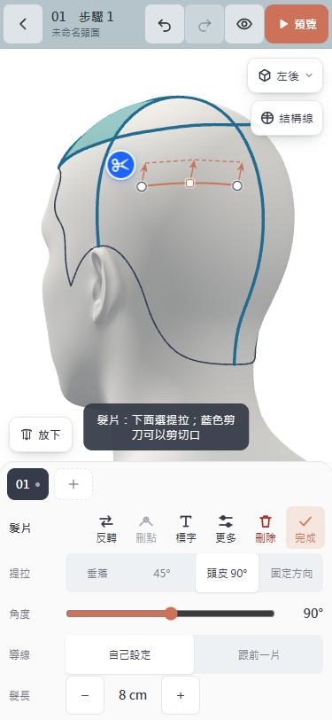
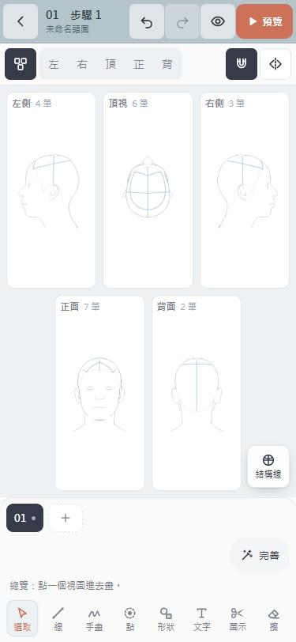

# headmap (頭圖 3D)

[日本語](README.md) | [繁體中文](README.zh-Hant.md) | **English**

A web app for drawing haircut diagrams. It offers two kinds of drawings: **3D** (draw directly on a head model and turn it to any angle) and **2D five views** (flat charts of the left, right, top, front and back, with line art generated from the head model).
Build a diagram step by step, then preview it as an animation and save it as images, a PDF, a video or an exportable file. It runs in the browser on phones, tablets and computers, with nothing to install and no account.

**Live site: <https://headmap.pages.dev/>**

<p align="center">
  
  &nbsp;&nbsp;
  
</p>

- Fully static: no backend, no build step, no packages to install. Put the folder on any static host and it works.
- Drawings are stored only in the user's own browser and are never sent to a server.
- To host your own copy, read the **[deployment guide](docs/DEPLOY.en.md)** (Cloudflare Pages, GitHub Pages, Netlify, Vercel, your own server).

> The interface is in Traditional Chinese.

## Features

- **Four head models:** female (MakeHuman), realistic female and realistic male (Blender), and neutral (ICT-FaceKit, the default). New 3D drawings start on head 4; switch heads from the eye menu in the top right, and what you have drawn moves to the matching position on the new head. Switching back restores the original. 2D drawings always use head 2.
- **3D drawing:** points; lines (two-point, horizontal, vertical, forward diagonal, backward diagonal, radial, freehand); areas (sectioning templates, tap to fill, lasso); hair panels (elevation angle, length, direction, cutting line); elevation lines; angle fans. Lines can be bent, given extra points, repeated in parallel and mirrored left/right, and labelled with text.
- **2D drawing:**
  - Lines: straight, arrow, curve (drag a straight line, then pull its middle), curved arrow, polyline. Ends can be arrows, dots or short bars. Solid, dashed or dotted; five widths; ten colours plus a custom colour.
  - Freehand lines (four smoothing levels), points (filled, hollow, cross, x), circles, ellipses, lasso areas, polygon areas, tap to fill, angles (the degrees are written automatically), text (bold, white box, rotate, scale) and tool icons (scissors, thinning shears, razor, clippers, comb, round brush, clip, fingers, spray bottle, hair dryer).
  - Eraser: remove a whole stroke, or only a segment (the line is split).
  - Snapping: to the 15 reference points, other line ends, the head outline and the hairline. Near-horizontal, near-vertical and near-45° lines straighten themselves; guide lines appear when aligned with other line ends.
  - Mirroring: on symmetric views, drawing one side draws the other; strokes on the left view are drawn on the right view; editing one side updates the other. A whole side can also be mirrored at once.
  - Tidy lines: joins line ends that are close together and extends ends to meet the head outline or another line.
  - Sectioning templates (centre parting, ear to ear, four sections, U-section, fringe triangle) are placed from the head model's reference points and projected onto the visible views.
  - A selection can be moved, reshaped, duplicated, reversed, flipped, rotated, reordered, restyled together with strokes of the same kind, moved to the next step and labelled.
  - Magnifier (while a finger is down), grid or dot background, light shading, structure lines with the 15 points (toggled together), point names; each view can use your own photo as its background and carry notes.
- **Steps:** a drawing can have several steps; earlier steps are shown faded beneath later ones.
- **Preview:** 3D flips through the steps; 2D draws stroke by stroke (parallel lines are drawn together, three speeds, play everything from the start). The download button in the top right saves what is on screen as a photo (on phones it can go to the photo library).
- **Library:** folders, favourites, search, sorting, duplication, a trash bin (emptied after 30 days) and thumbnails. Each drawing can carry notes and up to six photos.
- **Output:** 2000×2000 transparent PNG per 3D step; for 2D, a PNG of one view, a five-view sheet PNG, a PDF (sheet, each view, notes, photos), an animation video (MP4 or WebM) and social carousel images (1080×1350, ZIP). A single drawing or the whole library exports to JSON (photos included) and can be imported again.

## Controls

| Action | Phone, tablet | Computer |
|---|---|---|
| Draw | 3D: drag or tap with one finger inside the hairline outline; 2D: one finger | Left mouse button |
| Rotate the head (3D) | Drag with one finger outside the outline, or with two fingers anywhere | Right-button drag |
| Pan (2D) | Two-finger drag, or drag empty space with the Select tool | Right-button drag |
| Zoom | Pinch | Mouse wheel |
| Select a stroke | Tap it with the Select tool | Same |
| Undo, redo | The arrows at the top | Ctrl+Z, Ctrl+Shift+Z |
| 2D shortcuts | | V select, L line, P freehand, D point, S shape, T text, I icon, E eraser, 1–5 switch view, 0 overview, arrow keys nudge, Ctrl+D duplicate |

## Run it locally

Requires [Node.js](https://nodejs.org/) 18 or later. There is nothing to `npm install`.

```bash
git clone https://github.com/headmap-app/headmap.git
cd headmap
node server.mjs
```

Open <http://127.0.0.1:8080/>.

| Command | Purpose |
|---|---|
| `node server.mjs` | Local preview, reachable from this computer only |
| `node server.mjs --port 9000` | Use another port |
| `node server.mjs --lan` | Let phones and tablets on the same network connect (the addresses are printed in the terminal) |
| `npm test` | Run the tests |

Opening `index.html` directly does not work (`file://` cannot load the JavaScript modules); use a server.

## Deployment

The site is fully static: put the folder on any static host and you are done. There is no build.

| Platform | How |
|---|---|
| Cloudflare Pages | Connect GitHub, framework preset "None", leave the build command and output directory empty |
| GitHub Pages | Settings → Pages → deploy from the root of the `main` branch |
| Netlify, Vercel | Import the repository, no build command, publish the root |
| Your own server | Serve the files with nginx, Caddy, Apache or any static server |

Step-by-step instructions, what to change after going live and the licence obligations are in **[docs/DEPLOY.en.md](docs/DEPLOY.en.md)**.

## Browser support

Import maps and WebGL 2 are required: Chrome / Edge 89+, Safari 16.4+, Firefox 108+.

## Project layout

```
index.html, style.css     Page and styles
src/app.js                Screens, 3D tools, gestures, home screen
src/doc.js                Data format of a 3D stroke
src/library.js            Drawing library (drawings, steps, folders, trash, export/import)
src/heads.js              Head model list
src/transfer.js           Moves drawings to another head model
src/scalp.js              Scalp surface geometry: picking, surface lines, fills
src/landmarks.js          The 15 reference points, hairline outline, structure lines
src/lift.js               Hair panels, elevation lines, angle fans
src/section.js            Parting shapes and parallel repeats
src/templates.js          Sectioning templates
src/fill.js               Tap to fill (3D)
src/geometry.js           Shared maths
src/glb.js                Head model file reader
src/head-style.js         Head model material and lighting
src/flat/                 2D five views: views (views and projection), shapes (stroke format and geometry),
                          template (line art from the head model), render (SVG and canvas), snap (snapping,
                          tidy lines, fill), anim (animation), media (photos, PDF, ZIP), editor
assets/heads/             Four head models, landmark data, head-switch reference points, licence texts
vendor/                   three.js, three-mesh-bvh (vendored; nothing to install)
server.mjs                Static server for local preview
test/                     Tests (npm test)
tools/build-transfer.mjs  Regenerates the head-switch reference points (assets/heads/transfer.json)
docs/                     Deployment guide and images
_headers, .nojekyll       Host settings for Cloudflare Pages / Netlify and GitHub Pages
```

Code comments are written in Traditional Chinese.

## Where data is stored

Drawings are kept in the browser's localStorage; photos, custom backgrounds and thumbnails are kept in the browser's IndexedDB. Nothing is sent to a server. Clearing the site data in the browser removes them, so export important drawings first.

Data is tied to the address: the same code served from a different address (origin) has its own separate library. To move to another address, export all drawings from the home menu at the old address and import the JSON at the new one.

Safari on iPhone and iPad: for sites that were not added to the Home Screen, localStorage and IndexedDB are deleted after seven days of browser use without a visit ([WebKit's explanation](https://webkit.org/tracking-prevention/)). Sites added to the Home Screen are not affected. The app shows this reminder in its About sheet and home menu.

## Issues and contributions

Please open an [issue](https://github.com/headmap-app/headmap/issues) for problems and suggestions. Run `npm test` before sending a pull request.

## Licence

The code of this project is licensed under the [GNU Affero General Public License v3.0](LICENSE) (AGPL-3.0-only), Copyright (C) headmap.
If you offer a modified version over a network, you must make the source code of that version available to its users. Source: <https://github.com/headmap-app/headmap>

The head models, three.js and three-mesh-bvh are not covered by this licence; each follows its own licence listed below.

## Third-party sources and licences

- Head 1: base mesh and system assets from MakeHuman / [MPFB 2](https://github.com/makehumancommunity/mpfb2) (CC0).
- Heads 2 and 3: Human Base Meshes v1.4.1 from Blender Studio (Dan Ulrich, CC0); the licence text is in `assets/heads/licenses/`.
- Head 4: [ICT-FaceKit](https://github.com/USC-ICT/ICT-FaceKit) (USC Institute for Creative Technologies, MIT); the licence text is in `assets/heads/licenses/`. The shoulders use the MakeHuman / MPFB base mesh (CC0).
- All four were cropped to a bust, scaled and aligned, had holes filled and had the ears marked.
- [three.js](https://threejs.org/) (MIT) and [three-mesh-bvh](https://github.com/gkjohnson/three-mesh-bvh) (MIT); the licence texts are in their folders under `vendor/`.
