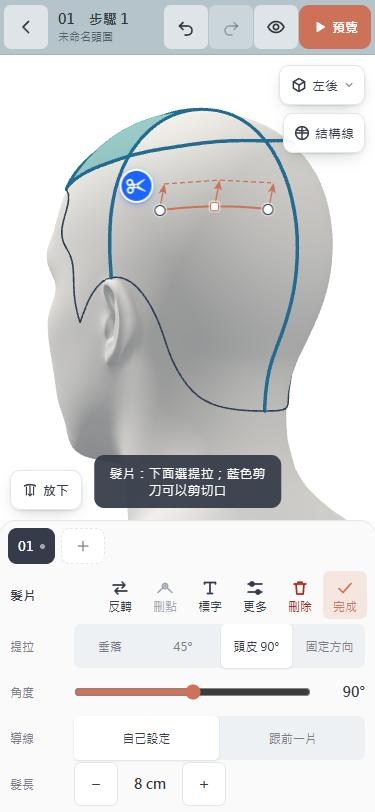
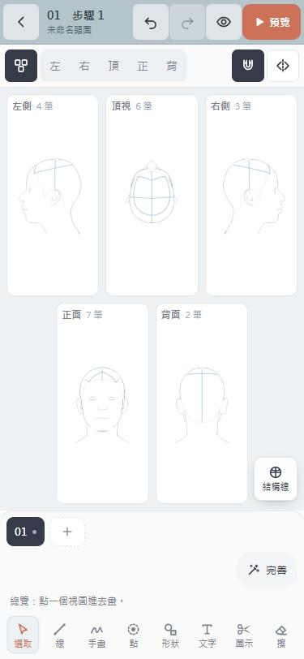

# 頭圖 3D（headmap）

**繁體中文** | [English](README.en.md)

畫剪髮圖解的網頁。兩種頭圖：**3D**（直接畫在頭模上，可以轉到任何角度）與 **2D 五視圖**（左側、右側、頂視、正面、背面的平面圖，底圖照頭模畫出來）。
一步一步畫，畫好可以預覽動畫、存成圖、PDF、影片或匯出。手機、平板、電腦的瀏覽器都能用，不用安裝，也不用帳號。

**線上版：<https://headmap.pages.dev/>**

<p align="center">
  
  &nbsp;&nbsp;
  
</p>

- 純靜態網頁：沒有後台、沒有建置步驟、沒有要安裝的套件，整個資料夾放到任何靜態主機就能用。
- 畫的圖只存在使用者自己的瀏覽器裡，不會傳到任何伺服器。
- 想架一份自己的：看 **[部署說明](docs/DEPLOY.md)**（Cloudflare Pages、GitHub Pages、Netlify、Vercel、自己的主機）。

## 能做什麼

- **四顆頭模**：女性（MakeHuman）、寫實女性與寫實男性（Blender）、中性（ICT-FaceKit，預設）。3D 新增時用頭模 4，在右上角的眼睛換頭模，已經畫的圖跟著搬到新頭上相對的位置，換回原本那顆就是原樣。2D 固定用頭模 2（不能換）。
- **3D 畫圖**：點、線（兩點、水平、垂直、前斜、後斜、放射、手畫）、面（分區樣板、點一下填滿、自己圈）、髮片（提拉角度、髮長、轉向、切口）、提拉線、角度扇形。線可以拉彎、加點、平行重複、左右鏡像，也可以在旁邊標字。
- **2D 畫圖**：
  - 線：直線、箭頭、曲線（先拉直線再拖中間彎起來）、曲線箭頭、折線；兩端可以是箭頭、圓點或短橫；實線、虛線、點線，五種粗細、十種顏色加自訂色。
  - 手畫線（四段平滑）、點（實心、空心、十字、叉）、圓、橢圓、圈出一塊面、點連成面、點一下填滿、角度（自動寫度數）、文字（粗體、白底框、旋轉、縮放）、工具圖示（剪刀、打薄剪、剃刀、電剪、梳子、圓梳、夾子、手指、噴水、吹風機）。
  - 橡皮擦：整筆擦掉，或只擦一段（線會斷開）。
  - 磁吸：吸到十五點、別的線端、頭的外框與髮際線；接近水平、垂直、45° 自動轉正；對齊別的線端時出現輔助線。
  - 鏡像：對稱的視圖畫一邊另一邊自動畫，左側畫的自動畫到右側；改一邊，另一邊跟著改。也可以整側鏡像。
  - 完善線條：線端很近的接起來，靠近頭的外框或別的線的延長到剛好碰到。
  - 分區樣板（正中線、耳到耳、四區、U型區、瀏海三角）照頭模的點位畫，投影到看得到的視圖。
  - 選取後可以移動、改端點與彎度、複製、反向、翻轉、旋轉、改圖層上下、同類一起換樣式、移到下一步、標字。
  - 放大鏡（手指按著時）、格線或點陣背景、淡淡的立體明暗、結構線與十五點（一起開關）、點位名稱；每個視圖可以換成自己的照片當底圖、寫筆記。
- **步驟**：一張頭圖可以有好幾個步驟，前面的步驟會用淡色疊在後面。
- **預覽**：3D 一步一步翻；2D 一筆一筆畫出來（平行的線同時畫，速度三段，可以從頭播全部）。右上角的下載鈕把看到的畫面存成照片（手機可以存到相簿）。
- **我的頭圖**：資料夾、收藏、搜尋、排序、複製、回收桶（30 天後自動清掉）、縮圖；每張頭圖可以有筆記和最多 6 張照片。
- **輸出**：3D 每一步 2000×2000 透明 PNG；2D 的單一視圖 PNG、五視圖總表 PNG、PDF（總表、各視圖、筆記、照片）、動畫影片（MP4 或 WebM）、社群輪播圖（1080×1350，ZIP）；一張頭圖或整個頭圖庫匯出成 JSON（含照片），可以再匯入。

## 操作

| 動作 | 手機、平板 | 電腦 |
|---|---|---|
| 畫 | 3D：在頭髮外輪廓裡面單指拖或點；2D：單指 | 滑鼠左鍵 |
| 轉頭（3D） | 在外輪廓外面單指拖，或任何地方雙指拖 | 右鍵拖 |
| 移動畫面（2D） | 雙指拖，或用「選取」拖空白處 | 右鍵拖 |
| 縮放 | 雙指捏合 | 滾輪 |
| 選取一筆 | 用「選取」工具點它 | 同左 |
| 復原、重做 | 上方的箭頭 | Ctrl+Z、Ctrl+Shift+Z |
| 2D 快速鍵 | | V 選取、L 線、P 手畫、D 點、S 形狀、T 文字、I 圖示、E 擦、1～5 換視圖、0 總覽、方向鍵微調、Ctrl+D 複製 |

## 在自己的電腦上跑

需要 [Node.js](https://nodejs.org/) 18 以上；不用 `npm install`（沒有要裝的套件）。

```bash
git clone https://github.com/headmap-app/headmap.git
cd headmap
node server.mjs
```

打開 <http://127.0.0.1:8080/>。

| 指令 | 用途 |
|---|---|
| `node server.mjs` | 本機預覽，只有這台電腦連得到 |
| `node server.mjs --port 9000` | 換埠號 |
| `node server.mjs --lan` | 讓同一個網路的手機、平板也連得進來（終端機會印出網址） |
| `npm test` | 跑測試 |

不能直接用瀏覽器打開 `index.html`（`file://` 載不了程式模組），要透過伺服器。

## 部署

網頁是純靜態的，把整個資料夾放到任何靜態主機就完成了，不用建置。

| 平台 | 做法 |
|---|---|
| Cloudflare Pages | 連 GitHub，架構選「無」，建置指令與輸出目錄留空 |
| GitHub Pages | Settings → Pages → 從 `main` 分支的根目錄發佈 |
| Netlify、Vercel | 匯入 repo，不填建置指令，發佈目錄用根目錄 |
| 自己的主機 | 把檔案放到 nginx、Caddy、Apache 等任何靜態伺服器 |

每一步怎麼按、上線後要改哪幾個地方、授權上要注意什麼，都寫在 **[docs/DEPLOY.md](docs/DEPLOY.md)**。

## 瀏覽器

要支援 import map 與 WebGL 2：Chrome／Edge 89 以上、Safari 16.4 以上、Firefox 108 以上。

## 檔案

```
index.html、style.css     頁面與樣式
src/app.js                畫面、3D 工具、手勢、首頁
src/doc.js                3D 一筆圖的資料格式
src/library.js            頭圖庫（頭圖、步驟、資料夾、回收桶、匯出匯入）
src/heads.js              頭模清單
src/transfer.js           換頭模時把圖搬到新頭上
src/scalp.js              頭皮表面的幾何：點選、貼表面的線、填色
src/landmarks.js          十五點、頭髮外輪廓、結構線
src/lift.js               髮片、提拉線、角度扇形
src/section.js            分線形狀與平行重複
src/templates.js          分區樣板
src/fill.js               點一下填滿（3D）
src/geometry.js           共用的數學
src/glb.js                讀頭模檔
src/head-style.js         頭模的材質與燈光
src/flat/                 2D 五視圖：views（視圖與投影）、shapes（筆的格式與幾何）、template（從頭模畫線稿）、
                          render（SVG 與 canvas 畫法）、snap（吸附、完善線條、填滿）、anim（動畫）、media（照片、PDF、ZIP）、editor（編輯器）
assets/heads/             四顆頭模、點位資料、換頭模的對照點、授權全文
vendor/                   three.js、three-mesh-bvh（原樣放進來，不用安裝）
server.mjs                本機預覽用的靜態伺服器
test/                     測試（npm test）
tools/build-transfer.mjs  重新產生換頭模的對照點（assets/heads/transfer.json）
docs/                     部署說明與說明用的圖
_headers、.nojekyll        給 Cloudflare Pages／Netlify 與 GitHub Pages 的設定檔
```

## 資料存在哪裡

頭圖存在瀏覽器的 localStorage，照片、自己的底圖與縮圖存在瀏覽器的 IndexedDB，不會傳到任何伺服器。清除瀏覽器的網站資料會一起清掉，重要的圖請先匯出。

資料跟著網址走：同一份程式放在不同的網址（網域），各自是一份獨立的頭圖庫。要換網址，請先在舊網址的首頁選單「匯出全部頭圖」，再到新網址「匯入 JSON」。

iPhone、iPad 的 Safari：沒有「加入主畫面」的網站，連續 7 天的使用中沒有打開過，localStorage 與 IndexedDB 會被清掉（[WebKit 的說明](https://webkit.org/tracking-prevention/)）；加入主畫面的不受影響。網頁的「關於」與首頁選單也有提醒。

## 回報問題與貢獻

問題和建議請開 [Issue](https://github.com/headmap-app/headmap/issues)。要送修改（Pull Request）之前，請先跑 `npm test`。

## 授權

本專案的程式碼以 [GNU Affero General Public License v3.0](LICENSE)（AGPL-3.0-only）授權，Copyright (C) headmap。
在網路上提供修改過的版本時，要讓使用者拿得到那個版本的原始碼。原始碼：<https://github.com/headmap-app/headmap>

頭模、three.js、three-mesh-bvh 不在這個授權裡，各依下面列的授權。

## 第三方來源與授權

- 頭模 1：MakeHuman／[MPFB 2](https://github.com/makehumancommunity/mpfb2) 基礎網格與系統素材（CC0）。
- 頭模 2、3：Blender Studio 的 Human Base Meshes v1.4.1（Dan Ulrich，CC0），授權全文在 `assets/heads/licenses/`。
- 頭模 4：[ICT-FaceKit](https://github.com/USC-ICT/ICT-FaceKit)（USC Institute for Creative Technologies，MIT），授權全文在 `assets/heads/licenses/`；肩膀用 MakeHuman／MPFB 基礎網格（CC0）。
- 四顆都做過裁切成胸像、縮放對齊、補面、標出耳殼。
- [three.js](https://threejs.org/)（MIT）、[three-mesh-bvh](https://github.com/gkjohnson/three-mesh-bvh)（MIT），授權全文在 `vendor/` 各自的資料夾裡。
